# Space Quest JS

  

See app on:

- [Render](https://spacequest.onrender.com/ "See app on Render")
- [GitHub Pages](https://joeoregan.github.io/JS-SpaceQuest/ "See app on GitHub Pages")

---

## Space Quest JavaScript

Space Quest game ported to JavaScript from fourth-year Platform Game Development module. Originally coded as a cross-platform Android/PC/iOS game using Cocos2d-x.

---

### Links:

- [Play Web App (Work in progress)](https://spacequest.onrender.com/ "Play Render Web App (Work in progress)")
- [Space Quest: Original Version Repo](https://github.com/joeaoregan/LIT-Yr4-PlatformGameDevelopment "Space Quest: Original Version Repo")

---

### Screenshots:

###### Space Quest: Level 2 (Original Version)

---

###### Space Quest: Level 3
